# The public README standard

Every public quadseven repository has a README a stranger can read on a phone
in two minutes and come away knowing what the project is, how to run it, and
where it is going. The model is the Loom README: short sections, plain words,
real commands, and nothing on the page that is not true on `main`.

This file is a standard, not a synced file: `sync.public-repo-docs.yml` copies
only `AGENTS.md` and `CLAUDE.md`. Copy the skeleton below by hand and fill it in.

## The opening

- Line 1 is the product name as a `#` heading.
- Line 2 is one line that says what it is.
- Then two or three plain sentences: what it does, and for whom.
- No wall of badges, no banner image above the name, no table of contents.

## Required sections, in this order

| # | Section | What it must hold |
|---|---|---|
| 1 | What it does | What a user gets or sees. A short list or a numbered flow, not a feature dump. |
| 2 | Quick start | The fewest steps from a clean machine to the thing working: install, or open, or call. |
| 3 | How it works | The moving parts and how data or control flows between them, with one Mermaid diagram. |
| 4 | Run and test locally | The exact commands CI runs, copied from the workflow, so a green local run means a green CI run. |
| 5 | Configuration | Every setting a stranger must supply, where it lives (`.env.example`, a `.conf.dist`), and what infrastructure does not ship with the repo. |
| 6 | Status | One link to the live epic or goal issue that tracks the open work. Not a list of issue numbers, not a dated changelog. |
| 7 | Contributing | How a change lands: pull request only, the checks it must pass, and a pointer to `AGENTS.md`. |

A repo may add sections after these (Terms, Docs, License, Credits). A section
that does not apply says so in one line rather than disappearing: a library
with no settings writes "No configuration: everything is a function argument."

### Diagrams

Use a fenced `mermaid` block. GitHub renders it, and it reads the same in
every font. Never draw boxes with ASCII art or box-drawing characters: the
borders break on a phone and in any proportional font. Keep a diagram to a
dozen nodes or fewer; split it if it needs more.

## Style rules

- Short paragraphs: three or four lines. Tables where a list has two columns.
- Readable on a phone: no line of code wider than about 80 characters where
  it can be wrapped, no wide tables of prose.
- Every claim is true on `main`. Run each command before writing it. Check
  each file path, flag and setting name exists. A measurement carries its date.
- No stale vendors or retired services. If a dependency was removed, so is
  its paragraph.
- No history essays in the README. Where a project came from and why each
  decision was made belong in `DECISIONS.md` or `docs/`, linked once.
- Present tense, about the project, for a stranger. Not "I", not "we
  decided last week".

### Public-repo text rules (from `AGENTS.md`)

- ASCII only: no em or en dashes, no smart quotes, no arrow glyphs, no
  box-drawing characters, no emoji. Write `->` and `-`.
- No personal names. Refer to people by role: the operator, a maintainer.
- No hostnames except the product's own public domain, no IP addresses, no
  local paths, no device identifiers, no secrets of any kind.
- No private repository names or internal system names.
- Never write an at-sign directly followed by the review bot's short name: that
  handle belongs to an unrelated real person. Name the bot as `grug-tribe[bot]`
  or in backticks.

Run the leak scanner on a new README before opening the pull request:

```sh
python3 .github/scripts/check_private_leaks.py --text-file README.md
```

## Skeleton

Copy this, keep the headings, and replace every `<...>`.

~~~markdown
# <Name>

<One line: what it is.>

<Two or three sentences: what it does and who it is for.>

## What it does

1. <First thing a user sees or gets.>
2. <Second.>
3. <Third.>

## Quick start

```sh
<install or open command>
<first real use>
```

## How it works

```mermaid
flowchart LR
  A[<Input>] --> B[<Component>]
  B --> C[<Store or service>]
  B --> D[<Output>]
```



<One paragraph naming each box and what it owns.>

## Run and test locally

```sh
<the exact test command CI runs>
```

CI runs the same command on every pull request (`<workflow file>`).

## Configuration

| Setting | Where | What it does |
|---|---|---|
| `<NAME>` | `.env.example` | <one line> |

<What infrastructure the stranger must bring, if any.>

## Status

Open work is tracked in <link to the live epic or goal issue>.

## Contributing

Changes land through a pull request; direct pushes to `main` are refused.
Read [AGENTS.md](AGENTS.md) first: this repository is public.
~~~

## Reviewer checklist

Apply this to a README in one pass. Every box must be ticked.

- [ ] Opens with the name, a one-line description, and two or three sentences
      on what it does and for whom. No badge wall.
- [ ] Has What it does, Quick start, How it works, Run and test locally,
      Configuration, Status, Contributing, in that order.
- [ ] How it works has a Mermaid diagram and no ASCII box art.
- [ ] Run and test commands match what CI runs, and were run on `main`.
- [ ] Configuration names every setting a stranger must supply, and what
      infrastructure does not ship with the repo.
- [ ] Status links one live epic or goal issue, not a stale range of numbers.
- [ ] Every path, command, flag and number on the page is true on `main`.
- [ ] No retired service, removed vendor or history essay.
- [ ] ASCII only: no em dashes, smart quotes, arrows, box-drawing or emoji.
- [ ] No personal names, private hostnames, IPs, local paths, private repo
      names or secrets; no at-sign before the review bot's short name.
- [ ] The leak scanner passes on the file.
